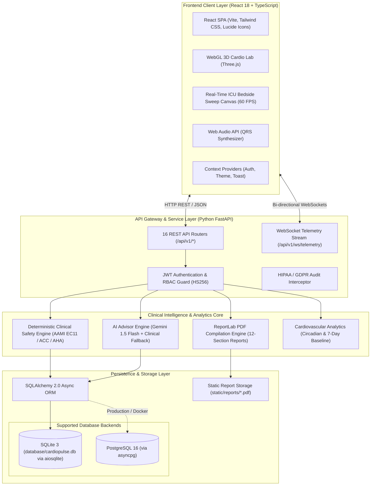
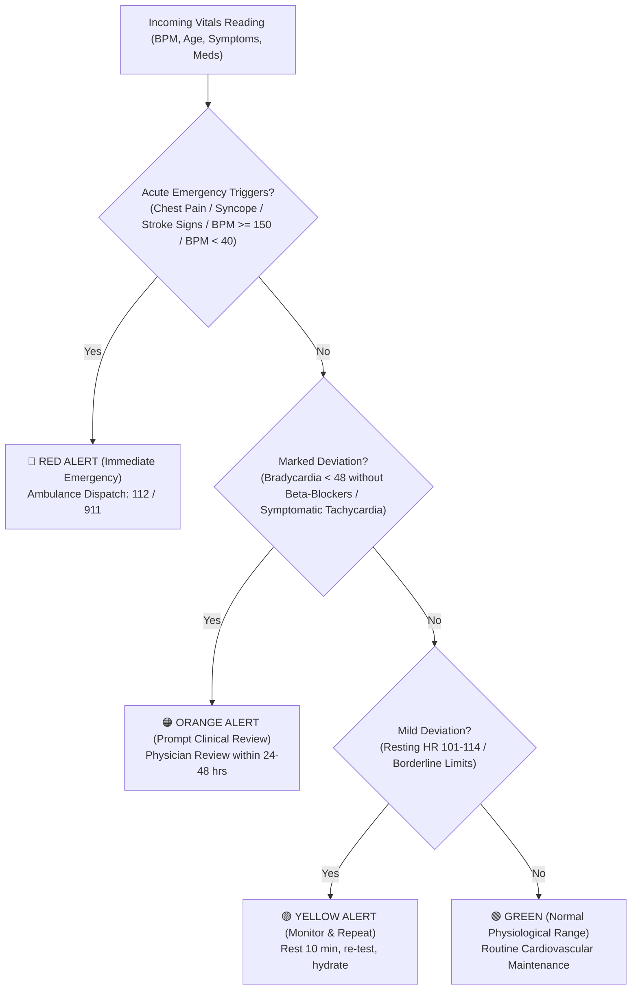
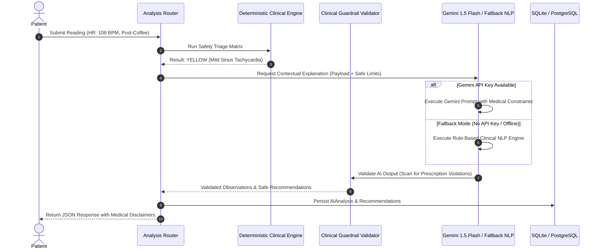
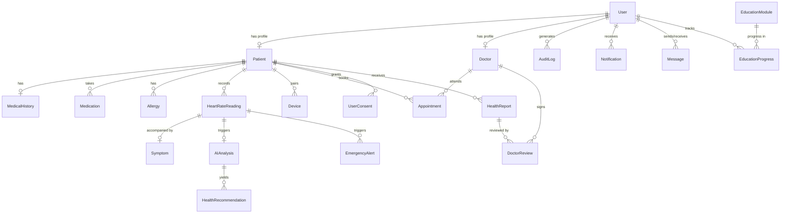
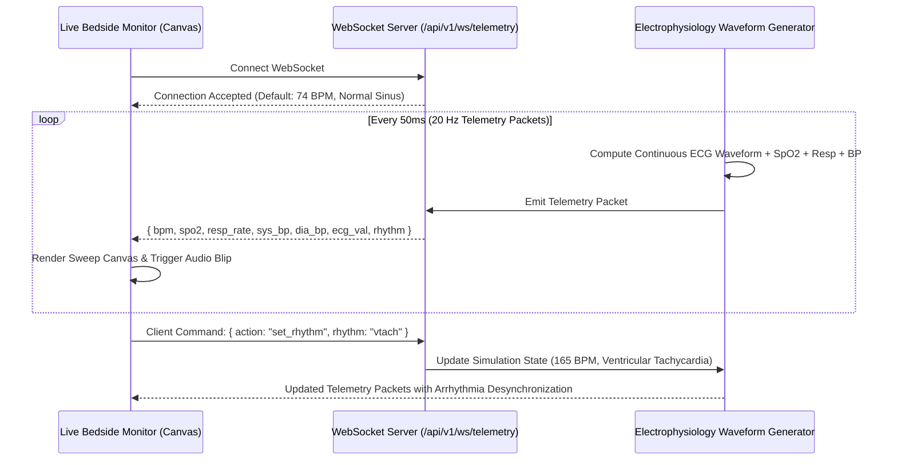
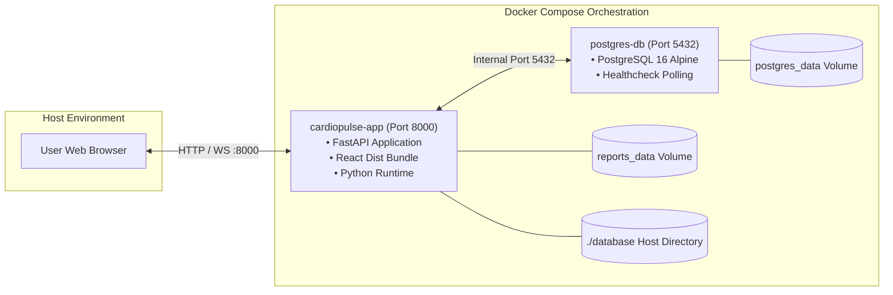

# CardioPulse AI — System Architecture & Technical Design Document

CardioPulse AI is an enterprise-grade clinical decision-support system (CDSS) and cardiovascular monitoring platform. It integrates real-time vitals telemetry, electrophysiological simulations, deterministic clinical triage (AAMI EC11 / ACC / AHA / ESC standards), generative AI insights, and multi-stakeholder governance across patients, attending cardiologists, and healthcare administrators.

---

## 0. Project Directory Structure

```
ECG_FINAL_PROJECT/
│
├── .env                                    # Runtime environment variables (secrets, DB URL, API keys)
├── .env.example                            # Template for .env (safe to commit)
├── .gitignore                              # Git ignore rules
├── ARCHITECTURE.md                         # ← This document
├── README.md                               # Project overview & quick-start guide
├── Dockerfile                              # Multi-stage container build (Node + Python)
├── docker-compose.yml                      # Orchestration: app + PostgreSQL
├── run.bat                                 # Windows one-click launcher
├── run.sh                                  # macOS / Linux one-click launcher
├── load_test.py                            # Locust / HTTP load-testing script
│
├── backend/                                # ═══ Python FastAPI Backend ═══
│   ├── __init__.py
│   ├── main.py                             # Uvicorn entry-point, lifespan, CORS, router mounting
│   ├── requirements.txt                    # Python dependencies (pip)
│   │
│   ├── app/                                # ── Core Application Package ──
│   │   ├── config.py                       # Settings (DB URL, JWT secret, Gemini key, paths)
│   │   ├── database.py                     # SQLAlchemy 2.0 async engine & session factory
│   │   ├── models.py                       # 21 ORM models (User, Patient, Doctor, ECGPrediction…)
│   │   ├── schemas.py                      # Pydantic request / response schemas
│   │   ├── auth.py                         # JWT token creation, bcrypt hashing, user dependency
│   │   ├── seed_data.py                    # Demo data seeder (runs on first startup)
│   │   │
│   │   ├── clinical_engine.py              # Deterministic CDSS triage (4-tier safety matrix)
│   │   ├── ai_advisor.py                   # Gemini 1.5 Flash + rule-based NLP fallback
│   │   ├── report_generator.py             # ReportLab PDF compilation (12-section reports)
│   │   │
│   │   ├── ml/                             # ── Machine Learning ECG Classification ──
│   │   │   ├── model_loader.py             # Loads ecg_model_metadata_bundle.joblib at startup
│   │   │   ├── predictor.py                # predict_ecg(): 54-feature → class + probabilities
│   │   │   └── feature_validator.py        # Input validation & feature-name checks
│   │   │
│   │   └── routers/                        # ── API Route Handlers (17 Routers) ──
│   │       ├── auth.py                     # POST /login, /register, /me
│   │       ├── patients.py                 # CRUD patient profiles & lifestyle data
│   │       ├── readings.py                 # Heart-rate reading intake + symptom tags
│   │       ├── analysis.py                 # Clinical rule analysis + AI explanations
│   │       ├── predictions.py              # POST /predictions (ML ECG classify), sample features
│   │       ├── reports.py                  # Assemble & download PDF health reports
│   │       ├── doctor.py                   # Clinician triage roster & digital sign-offs
│   │       ├── chat.py                     # Clinical decision-support chatbot
│   │       ├── audit.py                    # Immutable HIPAA / GDPR audit ledger
│   │       ├── appointments.py             # Telehealth & urgent evaluation scheduling
│   │       ├── messages.py                 # Doctor ↔ Patient secure messaging
│   │       ├── notifications.py            # Clinical notification dispatcher
│   │       ├── devices.py                  # Wearables hub (smartwatch, BLE, oximeter)
│   │       ├── education.py                # Cardiac Academy modules & quizzes
│   │       ├── admin.py                    # Hospital KPI analytics & user lifecycle
│   │       ├── analytics.py                # Circadian profiles & baseline deviations
│   │       └── telemetry_ws.py             # Real-time WebSocket vitals streaming
│   │
│   ├── models/                             # ── Trained ML Artefacts ──
│   │   └── ecg_model_metadata_bundle.joblib  # Extra Trees classifier (96.67% acc, 4 classes)
│   │
│   ├── static/
│   │   └── reports/                        # Generated PDF reports stored here
│   │       └── REP-2026-001-A.pdf          # (example seeded report)
│   │
│   └── tests/                              # ── Backend Unit & Integration Tests ──
│       ├── test_clinical_engine.py         # Tests for deterministic triage logic
│       └── test_ai_and_reporting.py        # Tests for AI advisor + PDF generation
│
├── frontend/                               # ═══ React 18 + TypeScript SPA ═══
│   ├── index.html                          # Vite HTML entry-point
│   ├── package.json                        # Node dependencies & scripts
│   ├── package-lock.json                   # Locked dependency versions
│   ├── vite.config.ts                      # Vite config (port 3000, proxy → :8000)
│   ├── tsconfig.json                       # TypeScript compiler options
│   ├── tailwind.config.js                  # Tailwind CSS theme customisation
│   ├── postcss.config.js                   # PostCSS plugins (Tailwind, Autoprefixer)
│   │
│   ├── src/
│   │   ├── main.tsx                        # React DOM root + provider wrappers
│   │   ├── App.tsx                         # Route definitions & layout
│   │   ├── index.css                       # Global styles + Tailwind directives
│   │   │
│   │   ├── context/                        # ── React Context Providers ──
│   │   │   ├── AuthContext.tsx             # JWT auth state, login/logout, role guard
│   │   │   ├── ThemeContext.tsx            # Light / Dark theme toggle (persisted)
│   │   │   └── ToastContext.tsx            # System-wide toast notifications
│   │   │
│   │   ├── services/
│   │   │   └── api.ts                      # Axios HTTP client (base URL, interceptors)
│   │   │
│   │   ├── types/
│   │   │   └── index.ts                    # Shared TypeScript interfaces & types
│   │   │
│   │   ├── components/                     # ── Reusable UI Components ──
│   │   │   ├── Navbar.tsx                  # Top navigation bar (role-aware)
│   │   │   ├── EmergencyBanner.tsx         # RED alert banner with 112/911 dispatch
│   │   │   ├── AIInsightCard.tsx           # AI analysis result display card
│   │   │   ├── HeartRateTrendChart.tsx     # Recharts longitudinal HR line chart
│   │   │   ├── HeartRateZoneGauge.tsx      # Radial gauge for HR zone classification
│   │   │   ├── LiveECGMonitorCanvas.tsx    # Canvas-based real-time ECG sweep
│   │   │   ├── BedsideTelemetryMonitor.tsx # Full ICU bedside multi-wave monitor
│   │   │   ├── InteractiveHeart3D.tsx      # Three.js 3D anatomical heart model
│   │   │   └── ReportViewerModal.tsx       # PDF report preview modal
│   │   │
│   │   └── pages/                          # ── Page-Level Route Components ──
│   │       ├── LandingPage.tsx             # Public landing / marketing page
│   │       ├── LoginPage.tsx               # User login form
│   │       ├── RegisterPage.tsx            # New user registration
│   │       ├── PatientDashboard.tsx        # Patient home dashboard
│   │       ├── HeartRateMonitoringPage.tsx # Live HR monitoring & reading submission
│   │       ├── AIAnalysisPage.tsx          # AI-powered clinical analysis view
│   │       ├── ECGPredictionPage.tsx       # ML ECG 54-feature prediction form
│   │       ├── PredictionHistoryPage.tsx   # Past ECG prediction records
│   │       ├── ReportsPage.tsx             # Health report listing & PDF downloads
│   │       ├── HealthTimelinePage.tsx      # Longitudinal health event timeline
│   │       ├── CardiovascularAnalyticsPage.tsx  # Circadian & baseline analytics
│   │       ├── Cardiovascular3DHubPage.tsx # 3D interactive heart exploration
│   │       ├── ChatAssistantPage.tsx       # Clinical chatbot interface
│   │       ├── DoctorDashboardPage.tsx     # Clinician triage & review cockpit
│   │       ├── PatientManagementPage.tsx   # Doctor: manage assigned patients
│   │       ├── CommunicationPage.tsx       # Secure messaging centre
│   │       ├── DeviceManagementPage.tsx    # Wearable device pairing & status
│   │       ├── EducationCenterPage.tsx     # Cardiac Academy learning modules
│   │       ├── AdminDashboardPage.tsx      # Admin: hospital KPIs & user mgmt
│   │       └── SettingsPrivacyPage.tsx     # Privacy consent & account settings
│   │
│   └── dist/                               # ── Production Build Output ──
│       ├── index.html
│       └── assets/
│           ├── index-BwhSV24D.js           # Bundled JS
│           └── index-Dignp8NV.css          # Bundled CSS
│
├── database/                               # ═══ Database Directory ═══
│   ├── .gitkeep
│   ├── README.md                           # Database setup & management docs
│   ├── manage_db.py                        # CLI: init, inspect, backup, reset DB
│   └── cardiopulse.db                      # SQLite database file (auto-created)
│
├── ml_assets/                              # ═══ ML Training & Evaluation Scripts ═══
│   └── ecg_testing_final.py                # Model training / evaluation notebook script
│
├── static/
│   └── reports/
│       └── .gitkeep                        # Placeholder for report storage
│
└── .venv/                                  # Python virtual environment (not committed)
```

---

## 1. High-Level Architecture Overview

CardioPulse AI follows a modern, decoupled **Layered Client-Server Architecture** featuring an asynchronous FastAPI backend and a high-performance React TypeScript Single Page Application (SPA).



---

## 2. Component Layers & Subsystems

### 2.1. Frontend Architecture (React 18 + Vite + TypeScript)

The client application is built with modern component-driven patterns:

* **Build Tooling:** Vite with React 18, TypeScript strict mode, and PostCSS / Tailwind CSS.
* **Component Architecture:**
  * **Bedside ICU Sweep Monitor:** Uses HTML5 `<canvas>` rendering at 60 FPS (`requestAnimationFrame`) to plot Lead II ECG, SpO2 plethysmogram, thoracic impedance respiration, and arterial blood pressure waves.
  * **Audio Synthesis:** Employs the browser's native **Web Audio API** (`AudioContext`, `OscillatorNode`, `GainNode`) to synthesize realistic QRS complex beeps and alert tones.
  * **3D Anatomical Heart Hub:** Built using **Three.js** to render a 3D cardiovascular heart model showing anatomical chambers (atria, ventricles) and the cardiac conduction system (SA node, AV node, Bundle of His, Purkinje fibers).
  * **Data Visualizations:** Charting with **Recharts** for longitudinal heart rate zones, circadian resting patterns, and 7-day moving averages.
* **State Management:**
  * `AuthContext`: Manages current user credentials, roles (`patient`, `doctor`, `admin`), JWT tokens, and automated session renewal.
  * `ThemeContext`: Persistent Light / Dark theme tokens with glassmorphic UI elements.
  * `ToastContext`: System-wide toast notification alerts.

---

### 2.2. Backend & API Gateway (FastAPI 0.115)

The server architecture leverages Python 3.12+ with asynchronous I/O (`asyncio`):

* **Application Lifespan:** Automatic verification of directories (`static/reports/` and `database/`), database schema migration (`Base.metadata.create_all`), and initial database seeding via `seed_data.py`.
* **CORS Middleware:** Universal cross-origin policy allowing REST and WebSocket clients to communicate securely.
* **16 Dedicated Routers:**
  1. `auth.py`: Token generation, bcrypt password hashing, login, and registration.
  2. `patients.py`: Patient clinical profiles, lifestyle attributes (sleep, stress, smoking, caffeine), and emergency contacts.
  3. `readings.py`: Intake for heart rate readings with resting state and symptom tags.
  4. `analysis.py`: Orchestrates clinical rule analysis and contextual AI explanations.
  5. `reports.py`: Assembles 12-section clinical reports and generates downloadable PDFs.
  6. `doctor.py`: Clinician triage roster, review workflows, and digital cryptographic sign-offs.
  7. `chat.py`: Clinical decision-support chatbot with guardrails.
  8. `audit.py`: Tamper-evident audit ledger query endpoints.
  9. `appointments.py`: Telehealth, outpatient, and urgent cardiac evaluation scheduling.
  10. `messages.py`: Doctor-patient HIPAA-compliant secure messaging.
  11. `notifications.py`: Clinical notification dispatcher.
  12. `devices.py`: Wearables hub (smartwatches, BLE straps, pulse oximeters).
  13. `education.py`: Cardiac Academy modules and interactive quizzes.
  14. `admin.py`: Hospital-level KPI analytics, user lifecycle controls, and physician verification.
  15. `analytics.py`: Circadian profiles, baseline deviations, and tracking consistency scoring.
  16. `telemetry_ws.py`: Real-time bi-directional WebSocket streaming vitals and rhythm simulations.

---

## 3. Clinical Decision-Support & Safety Engine (CDSS)

The clinical safety logic is isolated in [`backend/app/clinical_engine.py`](file:///Users/manojbarik/Desktop/ECG SIGNAL MONITORING/ECG_FINAL_PROJECT/backend/app/clinical_engine.py) to ensure zero dependency on non-deterministic models for safety-critical triage.

### 3.1. Deterministic 4-Tier Safety Matrix



### 3.2. Clinical Standards & Baselines Enforced:
* **Pediatric Advanced Life Support (PALS):** Age-calibrated ranges:
  * Infant (< 1 yr): 80–160 BPM
  * Toddler (1–3 yr): 80–130 BPM
  * Preschool (4–5 yr): 80–120 BPM
  * School Age (6–12 yr): 70–110 BPM
  * Adolescent (13–17 yr): 60–100 BPM
* **Adult & Geriatric Guidelines (AHA / ACC / ESC):**
  * Healthy Adult (18–64 yr): 60–100 BPM
  * Conditioned Endurance Athlete: 40–60 BPM
  * Older Adult (65+ yr): 55–95 BPM
  * Pregnancy Adjustment: +10–15 BPM physiological elevation during 2nd and 3rd trimesters.
* **Pharmacological Impact Recognition:** Adjusts thresholds for patients on negative chronotropic drugs (Beta-Blockers, Non-DHP Calcium Channel Blockers, Digoxin).

---

## 4. AI Advisor & Generative Intelligence Layer

The natural language layer is contained in [`backend/app/ai_advisor.py`](file:///Users/manojbarik/Desktop/ECG SIGNAL MONITORING/ECG_FINAL_PROJECT/backend/app/ai_advisor.py) and operates with strict clinical guardrails.



### Safety Guardrails Enforced:
1. **Zero Medication Prescriptions:** Automatic screening strictly blocks any recommendation suggesting specific drug dosages or pharmacological prescriptions.
2. **Mandatory Clinical Disclaimers:** Every AI-generated output includes statutory legal notices that the system does not replace a licensed medical physician or a diagnostic 12-lead ECG.
3. **Deterministic Fallback:** If the external AI service is unreachable, timeout occurs, or the API key is unset, the local deterministic NLP engine guarantees zero disruption.

---

## 5. Database Architecture & Data Model

The persistence layer uses **SQLAlchemy 2.0 Async** supporting both SQLite (local/dev) and PostgreSQL (production).

### 5.1. Directory Separation
All SQLite data is housed in the dedicated [`database/`](file:///Users/manojbarik/Desktop/ECG SIGNAL MONITORING/ECG_FINAL_PROJECT/database/) folder:
* **Path:** `ECG_FINAL_PROJECT/database/cardiopulse.db`
* **Configuration:** Centralized in [`app/config.py`](file:///Users/manojbarik/Desktop/ECG SIGNAL MONITORING/ECG_FINAL_PROJECT/backend/app/config.py) using absolute resolution.
* **Management Tooling:** [`database/manage_db.py`](file:///Users/manojbarik/Desktop/ECG SIGNAL MONITORING/ECG_FINAL_PROJECT/database/manage_db.py) allows CLI initialization, table inspection, backups, and resets.

### 5.2. Entity-Relationship Model (21 Relational Tables)



---

## 6. Real-Time Telemetry & Simulation Pipeline

The bedside telemetry suite features synchronized bi-directional streaming over WebSockets:



---

## 7. Report Generation & Digital Sign-Off

Formal health analysis reports are compiled using **ReportLab** into downloadable multi-page PDFs:

1. **Compilation Structure (12 Standard Sections):**
   * Patient Biometrics & Identifying Metadata
   * Measurement Session Details (Device, Method, Resting Status)
   * Vitals Analytics (BPM, Zone, Age-Adjusted Baselines)
   * Symptom Audit & Critical Emergency Flagging
   * Deterministic Clinical Triage Assessment
   * AI-Assisted Clinical Observations & Contributing Factors
   * 7-Day Longitudinal Moving Statistics (Min, Max, Mean)
   * Evidence-Based Lifestyle & Clinical Recommendations
   * Emergency Contact Dispatch Protocols
   * Attending Cardiologist Review & Digital Signature Block
   * Cryptographic SHA-256 Document Verification Hash
   * Mandatory Regulatory CDSS Disclaimers
2. **Clinician Governance:**
   Attending physicians review the report via the Clinician Cockpit, append diagnostic notes, and apply a SHA-256 digital signature hash.

---

## 8. Security, Compliance & Governance

* **Authentication & Authorization (RBAC):** Stateless JSON Web Tokens (JWT) signed with HMAC-SHA256. Enforces granular access boundaries between patients, cardiologists, and administrators.
* **Password Hashing:** Implemented with `bcrypt` with automatic salting.
* **HIPAA & GDPR Immutable Audit Ledger:** The `audit_logs` table records user logins, vitals submissions, AI analyses, report views, and doctor sign-offs with IP addresses and timestamps.
* **Consent Governance:** The `user_consent` table explicitly tracks patient authorization for AI processing, clinical data sharing, and privacy policy versions.

---

## 9. Deployment & Orchestration

CardioPulse AI is containerized for seamless cross-platform deployment:



* **Local Development:** Instant execution using Windows `run.bat` or `python -m uvicorn main:app --app-dir backend --host 127.0.0.1 --port 8000 --reload`.
* **Containerized Deployment:** Multi-stage build (`node:20-alpine` builds frontend assets; `python:3.12-slim` runs the service). Orchestrated via `docker compose up -d --build`.

